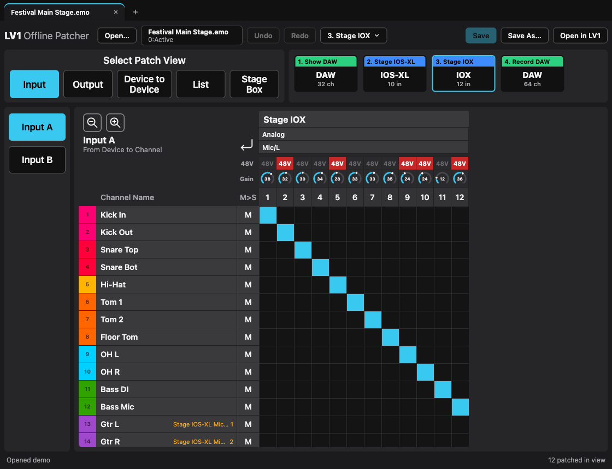
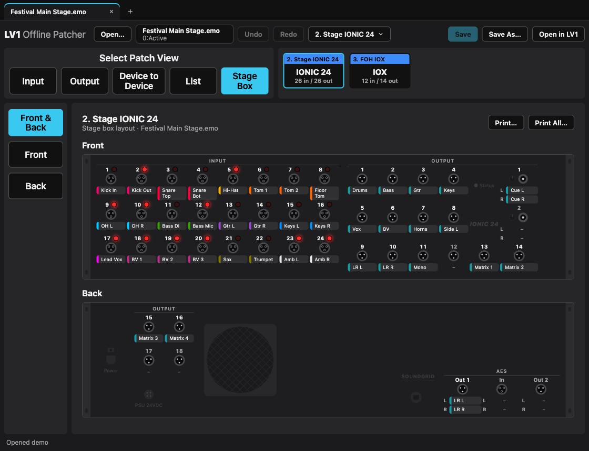

# LV1 Offline Patcher



Desktop app for macOS and Windows (Tauri 2 / Rust + Svelte 5) for editing the patch of a Waves LV1 showfile (`.emo`)
without the I/O hardware being online.

## Why

I want to be able to patch my devices offline: at home, before the show, without the stage boxes and DAWs
connected. For whatever reason LV1 only lets you patch devices that are currently available in the network. LV1 has
"offline devices" that can be used as placeholders, but that is inconvenient, and when I tried it a while ago I lost all gain
settings after swapping them for the real device. Maybe that has improved, but anyway.

This app edits the patch directly in the showfile, for every device in it, online or not. It also adds some
workflow improvements to patching, especially for DAWs: converting channel direct outs to device to device
patches (and back), setting up a virtual soundcheck, or copying the patch from one device to another.

It is not meant to replace Waves' offline editor. It does what Waves, for some reason, doesn't let you do
with your session. Use LV1 for everything else.

**To Waves Audio:** feel free to use the ideas here to make patching in LV1 better. I'd be happy if this app
became unnecessary.

## Usage

The views follow LV1's Patch page:

- **Input** (A/B): device inputs → channels, with gain and 48V of the selected device
- **Output**: channel direct outs and mix busses → device outputs, including the output source (INP/PRE/PST/PSP)
- **Device to Device**: device inputs → device outputs
- **List**: everything patched on one device, exportable as CSV
- **Stage Box**: the device's connectors labeled with what is patched to them, printable for the stage crew



The device menu (toolbar button or right-click on a device) has the workflow tools:

- **Convert DO → D2D / D2D → DO**: turn channel direct outs into device to device patches from the inputs
  that feed those channels, or back
- **Return Outputs to Input B**: virtual soundcheck, every recorded channel comes back on Input B
- **Copy Patch from Device…**: give a device the input and/or output patch of another one, e.g. when
  swapping a stage box, with a preview per channel
- **Driver Channels** of a DAW, **Rename…**, **Export Patch List…**

Click a cell to patch or unpatch, drag diagonally for a range. Double-click a name to rename it. Drag a
gain knob or type a value (gain can be edited on IOS-XL, IOX, IONIC 16/24 and LV1 Classic). Several
showfiles open in tabs and windows. Undo, redo and save use the usual shortcuts; nothing is written until
you save.

## How it works

The `.emo` file is an SQLite database. The app reads devices, channel names, colors and output
sources from the live mixer state (snapshot `-1`, "Active"). It changes only these things: the
`routes` table, plus in the live state the output source (INP/PRE/PST/PSP,
`PARAM_OUTPUT_DIRECT_SOURCE`), the driver channel count of DAWs, and the preamp settings. Stored
snapshots are not touched. Preamps (`control_gain_map`, `line_in_phantom_map`) live in a YAML
"IOM chunk" per device and snapshot (`iom_chunks` / `snapshot_iom`). The live state gets a new
chunk; snapshots that shared the old one keep it. **Note:** recalling a snapshot whose scope
includes the preamps brings back that snapshot's gain and 48V.

The file only stores channel counts per device, so the port types (Analog Line, Phones, AES, ...)
come from a table per device model in `src-tauri/src/layout.rs`. It covers the SoundGrid
interfaces from Waves' compatibility chart (DiGiGrid, IONIC, StageGrid, MADI/Dante bridges, ...).
A mono channel with a mono-to-stereo plugin (plugin code ending in `X`, e.g. RVerb) has a stereo direct out unless its
source is INP.
All file access happens in the Rust backend (`src-tauri/src/show.rs`). Edits stay in memory until
you save. **Save** first writes a `<file>.bak-<timestamp>` backup, then applies the changes in one transaction and checkpoints the
WAL into the `.emo`. **Close the show in LV1 before saving**: a non-empty `-wal` file means it is
still open, and the app asks before writing anyway.

Channel colors are an approximation of LV1's palette.

## Download

Installers for macOS (universal `.dmg`) and Windows (`-setup.exe` / `.msi`) are on the
[Releases](https://github.com/willihelm/lv1-offline-patcher/releases) page. The builds are not
code-signed: on macOS right-click the app and choose **Open** the first time (or run
`xattr -cr "/Applications/LV1 Offline Patcher.app"`); on Windows click **More info → Run anyway**
in the SmartScreen dialog. Windows needs the WebView2 runtime, which the installer fetches if missing.

The app checks for a new release when it starts and shows an **Update to …** button with the
changelog; on macOS, **Check for Updates…** in the app menu asks again. Installing restarts the app
and is refused while a showfile has unsaved changes.

## Development

```sh
npm install
npm run tauri dev          # desktop app
npm run tauri build        # release bundle in src-tauri/target/release/bundle
cd src-tauri && cargo test # runs on temp copies of src-tauri/testdata/lv1-test-session.emo
```

Commits follow [Conventional Commits](https://www.conventionalcommits.org/) (`feat:`, `fix:`, ...).
On every push to `main`, [release-please](https://github.com/googleapis/release-please) keeps a
release PR open that bumps the version in `package.json`, `tauri.conf.json` and `Cargo.toml` and adds
the `feat`/`fix` commits to `CHANGELOG.md`. `feat` bumps the minor version, `fix` the patch; a
`Release-As: 1.0.0` line in a commit body picks the version. Merging the PR tags the commit, creates
the GitHub release with the changelog as notes, and builds the macOS and Windows installers into it
(`.github/workflows/release.yml`). Those builds also carry the signed update bundles and the
`latest.json` the in-app updater reads; signing them needs the repository secret
`TAURI_SIGNING_PRIVATE_KEY`, the private half of `plugins.updater.pubkey` in `tauri.conf.json`.

`npm run dev` also runs the UI in a plain browser with a mock backend. It loads
`public/demo.json`, which you generate from the test session with
`cd src-tauri && cargo test dump_demo -- --ignored`.

`src-tauri/testdata/lv1-test-session.emo` is an empty LV1 session with mock devices: a DAW
(B0S0), an IOS-XL (B0S1), an IOX (B0S2) and a second DAW with 64 driver channels (B0S3), plus a
few named channels and patches.

## License

[MIT](LICENSE). Not affiliated with or endorsed by Waves Audio. The app writes to your showfiles; it makes a
backup before every save, but keep your own copy of anything that matters.
