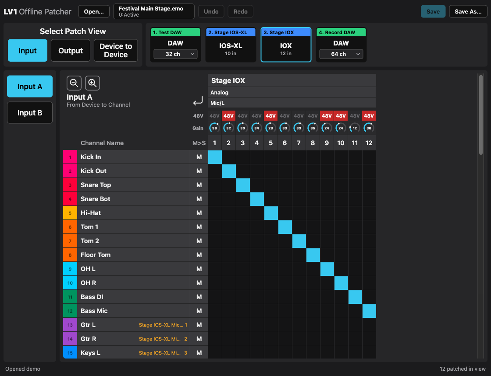

# LV1 Offline Patcher



Desktop app for macOS and Windows (Tauri 2 / Rust + Svelte 5) for editing the patch of a Waves LV1 showfile (`.emo`)
without the I/O hardware being online. The UI follows LV1's Patch page:

- **Input** (A/B): device inputs → channels (and Talkback)
- **Output**: Direct (channel direct outs) and Mix Busses (groups, auxes, mains, matrices, cue)
  → device outputs. The Source column sets the output source: INP, PRE, PST or PSP
- **Device to Device**: device inputs → device outputs
- **List**: everything patched on one device as a list: each input with gain, 48V and what it feeds, each
  output with its source (All / Inputs / Outputs). If an output comes straight from a device input (device to
  device), the list also shows the mixer channels that input feeds. **Export CSV…** saves it as a file
- **Stage Box**: the connectors of one I/O device, each labeled with the channel or mix patched to it, so you
  can cable the box without a list. The IONIC 16/24, LV1 Classic, DiGiGrid IOS-XL, IOX and D and DSPRO StageGrid
  1000/4000 are drawn front and back as on the hardware (choose Front & Back, Front or Back); parts that are
  not patch points (fan, power, network) are only faint outlines. Other devices show their connectors grouped
  by port type (`src/lib/panels.ts` has the panel layouts). A red LED marks inputs with 48V on; phones and AES pairs share one connector (L/R). Read-only;
  **Print…** prints the panels on white in landscape for the stage crew (or saves them as PDF from the print dialog);
  **Print All…** prints every stage box of the show, one per page

The device button in the toolbar (it shows the selected device) opens the device menu; a right-click on a
device opens it too. For a DAW it sets the **Driver Channels** (patches on channels that no longer exist are
removed). **Convert DO → D2D** (direct outs to device to device) repatches
all channel direct outs on it straight from the device inputs that feed those channels (Input A,
or Input B if A is empty), bypassing the mixer. Channels without an input patch are skipped and listed in
the status bar. **Convert D2D → DO** goes the other way: every device input
patched to the device becomes the direct out of the channel it feeds (if several channels use it:
Input A first, then the lowest channel number). **Return Outputs to Input B** sets up a virtual
soundcheck: every output of the device that carries a channel (its direct out, or a device input patched
straight to the output that feeds the channel's Input A) comes back on the input of the same number of that
device, patched to Input B of the channel. E.g. Bass on output 11 → input 11 → Bass Input B. Outputs
without an input of the same number are skipped and listed in the status bar. Each conversion is one undo
step.

**Copy Patch from Device…** opens a dialog that gives a device the patch of another device, channel by
channel. Choose the two devices and **Inputs** and/or **Outputs**; the preview lists every channel that
changes with its patch now and after the copy. Uncheck channels to leave them as they are (Shift-click
checks or unchecks a range). Copying inputs repatches everything the other device's inputs feed (channels in
Input A and B, Talkback, device outputs) from the same inputs of this device. A destination has only one
source, so these patches move away from the other device, e.g. when swapping a stage box. Copying outputs
gives every output the source of the same output on the other device, or unpatches it; the other device
keeps its outputs. Channels the target device doesn't have are listed but can't be copied. A copy is one
undo step.

**Export Patch List…** saves a CSV of the device (semicolon separated with decimal comma, for Excel and
Numbers): every input with gain, 48V and what it feeds, then every output with its source.

In the Input view, the rows above the column numbers show the preamps of the selected I/O device.
Click **48V** to switch phantom power. Turn a gain knob by dragging up/down (Shift for fine)
or with the arrow keys. Double-click (or Enter) types a value: Enter confirms,
Tab moves to the next input, Esc cancels. Gain can be edited on the IOS-XL and IOX (0 to +59.5 dB
in 0.5 dB steps) and on the IONIC 16/24 and LV1 Classic (0 to +60 dB in 1 dB steps). Other
devices show their gain read-only because their range isn't known yet.

Click a cell to patch or unpatch it. Drag diagonally to patch a range; a drag that starts on a
patched cell unpatches instead. Click row names to select them (shift for a range, ⌘/Ctrl to
toggle), then press **Delete**. ⌘Z / ⇧⌘Z undo and redo, ⌘S saves, ⇧⌘S saves a patched copy
(on Windows: Ctrl+Z, Ctrl+Y, Ctrl+S, Ctrl+Shift+S).
Orange text marks patches that come from outside the current matrix (another device or source).

Several showfiles can be open at once, in tabs and windows like in a web browser: ⌘T opens a
new tab, ⌘N a new window, ⌘W closes a tab (asking if it has unsaved changes), ⌃Tab / ⇧⌘] and
⌘1–9 switch tabs (on Windows: Ctrl+T, Ctrl+N, Ctrl+W, Ctrl+Tab, Ctrl+1–9). Drag a tab along the
tab bar to reorder it. The button on a tab (or a right-click) moves it into a new window or into
another open window. A file that is already open is not opened twice, its tab is shown instead.

## How it works

The `.emo` file is an SQLite database. The app reads devices, channel names, colors and output
sources from the live mixer state (snapshot `-1`, "Active"). It changes only these things: the
`routes` table, plus in the live state the output source (INP/PRE/PST/PSP,
`PARAM_OUTPUT_DIRECT_SOURCE`), the driver channel count of DAWs, and the preamp settings. Stored
snapshots are not touched. Preamps (`control_gain_map`, `line_in_phantom_map`) live in a YAML
"IOM chunk" per device and snapshot (`iom_chunks` / `snapshot_iom`). The live state gets a new
chunk; snapshots that shared the old one keep it. **Note:** recalling a snapshot whose scope
includes the preamps brings back that snapshot's gain and 48V.

The file only stores channel counts per device, so the port types (Analog Line, Phones, AES, ...)
come from a table per device model in `src-tauri/src/layout.rs`. It covers the SoundGrid
interfaces from Waves' compatibility chart (DiGiGrid, IONIC, StageGrid, MADI/Dante bridges, ...).
A mono channel with a mono-to-stereo plugin (plugin code ending in `X`, e.g. RVerb) has a stereo direct out unless its
source is INP.
All file access happens in the Rust backend (`src-tauri/src/show.rs`). Edits stay in memory until
you save. **Save** first writes a `<file>.bak-<timestamp>` backup, then applies the changes in one transaction and checkpoints the
WAL into the `.emo`. **Close the show in LV1 before saving**: a non-empty `-wal` file means it is
still open, and the app asks before writing anyway.

Channel colors are an approximation of LV1's palette.

## Download

Installers for macOS (universal `.dmg`) and Windows (`-setup.exe` / `.msi`) are on the
[Releases](https://github.com/willihelm/lv1-offline-patcher/releases) page. The builds are not
code-signed: on macOS right-click the app and choose **Open** the first time (or run
`xattr -cr "/Applications/LV1 Offline Patcher.app"`); on Windows click **More info → Run anyway**
in the SmartScreen dialog. Windows needs the WebView2 runtime, which the installer fetches if missing.

## Development

```sh
npm install
npm run tauri dev          # desktop app
npm run tauri build        # release bundle in src-tauri/target/release/bundle
cd src-tauri && cargo test # runs on temp copies of src-tauri/testdata/lv1-test-session.emo
```

Commits follow [Conventional Commits](https://www.conventionalcommits.org/) (`feat:`, `fix:`, ...).
On every push to `main`, [release-please](https://github.com/googleapis/release-please) keeps a
release PR open that bumps the version in `package.json`, `tauri.conf.json` and `Cargo.toml` and adds
the `feat`/`fix` commits to `CHANGELOG.md`. `feat` bumps the minor version, `fix` the patch; a
`Release-As: 1.0.0` line in a commit body picks the version. Merging the PR tags the commit, creates
the GitHub release with the changelog as notes, and builds the macOS and Windows installers into it
(`.github/workflows/release.yml`).

`npm run dev` also runs the UI in a plain browser with a mock backend. It loads
`public/demo.json`, which you generate from the test session with
`cd src-tauri && cargo test dump_demo -- --ignored`.

`src-tauri/testdata/lv1-test-session.emo` is an empty LV1 session with mock devices: a DAW
(B0S0), an IOS-XL (B0S1), an IOX (B0S2) and a second DAW with 64 driver channels (B0S3), plus a
few named channels and patches.

## License

[MIT](LICENSE). Not affiliated with or endorsed by Waves Audio.
